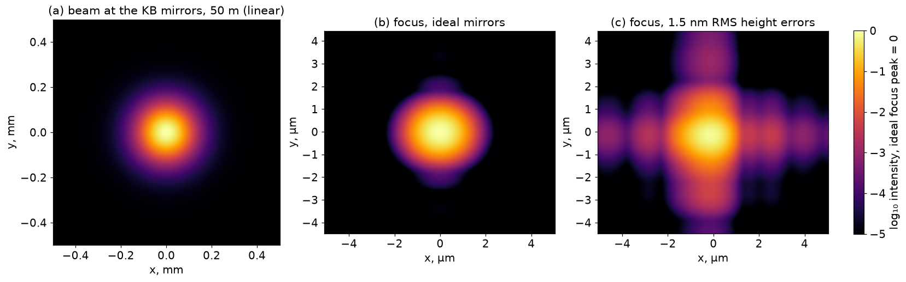
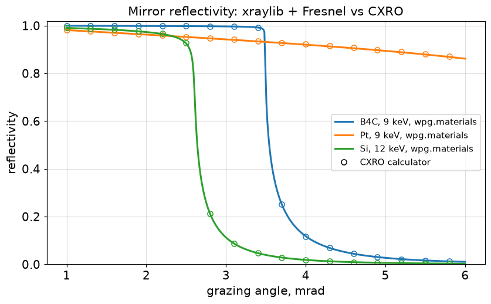
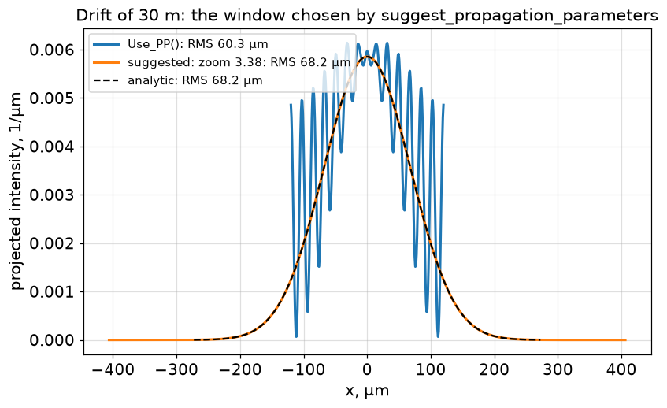
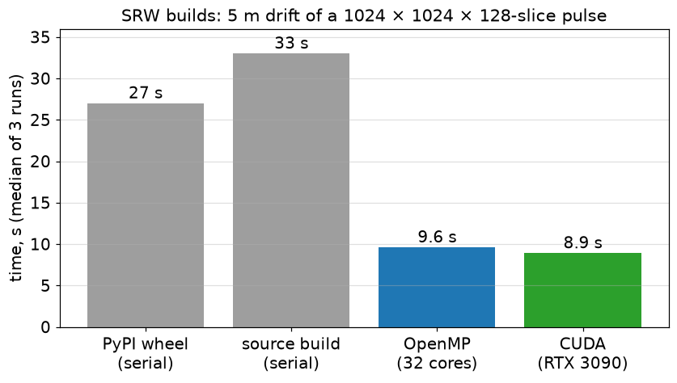

# WPG — WavePropaGator

**Wave-optics simulation of X-ray beamlines in Python, from the X-ray free-electron laser (XFEL) source to
the sample.**

WPG propagates X-ray wavefronts, including time-dependent XFEL pulses, through beamline optics with wave
optics, so diffraction, mirror surface errors and the finite size of optical elements are in the result.
The computations are done by the [SRW library](https://github.com/ochubar/SRW) of O. Chubar. WPG adds a
beamline that is a Python list of optical elements and a wavefront object with its parameters, field and
history stored in HDF5. WPG was developed for the design of the [European XFEL](https://www.xfel.eu)
beamlines ([Samoylova et al. 2016](https://doi.org/10.1107/S160057671600995X),
[Sinn et al. 2019](https://doi.org/10.1107/S1600577519003461)).



*Surface height errors of 1.5 nm RMS on the focusing mirrors spread a part of the focused beam into a
cross-shaped halo. A 9 keV Gaussian beam is focused by a pair of Kirkpatrick-Baez (KB) mirrors: two
elliptical mirrors with a B4C coating at a grazing angle of 3 mrad, one focusing in x and one in y.
(a) Intensity at the mirrors, 50 m from the source, linear scale (mm). (b), (c) Intensity at the focus on
a logarithmic scale normalized to the peak of the ideal focus (µm): (b) ideal mirrors, (c) random height
errors of 1.5 nm RMS on both mirrors. Each case takes 0.2 s on a laptop (Intel i7-14700HX, serial SRW),
[script](docs/images/make_showcase_figures.py).*

An overview in 10 slides: [PDF](docs/slides/WPG_2026.11.pdf), [PowerPoint](docs/slides/WPG_2026.11.pptx).

## What WPG does

- Propagates time-dependent XFEL pulses slice by slice in the frequency domain: pulses converted from the
  output of the FEL code GENESIS, files of the XFEL Photon Pulses Database (XPD), or Gaussian pulses.
- Models beamline optics: drifts, apertures, thin lenses, compound refractive lenses (CRL), plane,
  elliptical, hyperbolic, parabolic, spherical and toroidal mirrors, gratings with varied line spacing,
  and any other SRW optical element.
- Models real mirrors: reflectivity of the coating from optical constants (xraylib), measured height
  profiles, random surfaces with a given roughness spectrum, and pitch misalignment that deflects the beam.
- Checks the numerics: the phase step between neighbouring pixels and the intensity at the window border
  of a wavefront, and the automatic choice of the propagation window (zoom) and sampling for an element.
- Runs SRW built with OpenMP or CUDA from the latest sources (see [Installation](#installation)).
- Keeps wavefronts with their history in HDF5 for start-to-end simulations, e.g. in the SIMEX platform for
  simulations of experiments at the European XFEL ([Fortmann-Grote et al. 2017](https://doi.org/10.1107/S2052252517009496)).

<table>
<tr>
<td width="50%"><br>
<em>Reflectivity of thick mirrors versus grazing angle: B4C and Pt at 9 keV, Si at 12 keV, computed with
<code>wpg.materials</code> (lines) and with the
<a href="https://henke.lbl.gov/optical_constants/mirror2.html">CXRO calculator</a> (circles). The
difference is below 0.007 in absolute reflectivity at 1–6 mrad.</em></td>
<td width="50%"><br>
<em>Intensity profile (summed over y) of a 9 keV Gaussian beam after a 30 m drift. With the default
propagation parameters (blue) the beam reaches the window border and wraps around: the RMS size is
60.3 µm, 11.5 % below the analytic Gaussian profile (dashed, 68.2 µm). The window chosen by
<code>suggest_propagation_parameters</code> (orange, 3.38 times wider) reproduces the analytic
profile.</em></td>
</tr>
</table>

## Installation

WPG needs Python 3.10 or newer and is tested on Linux and Windows. The propagation is computed by SRW
(Synchrotron Radiation Workshop), the wave optics library under WPG, which WPG takes from the
[`srwpy`](https://pypi.org/project/srwpy/) package. Choose the SRW build first, because the install command
depends on it:

| SRW build | Use it for | Install command, in the WPG folder |
|---|---|---|
| Official wheel (ready binary package) from PyPI, one CPU core. Linux, macOS, Windows | the default: single wavefronts, any system | `python -m pip install -e ".[test,materials]" --config-settings editable_mode=compat` |
| Built from the sources with OpenMP. Linux | pulses of many slices on a multi-core machine | `make install SRW_MODE=omp` |
| Built from the sources with CUDA. Linux | the same on an NVIDIA GPU | `make install SRW_MODE=cuda` |

The OpenMP build propagates the slices of a pulse (its photon energies or times) in parallel, so it speeds up
time-dependent simulations, not a single monochromatic wavefront. For a 5 m drift of a 5 keV pulse of
1024 × 1024 points and 128 slices, the OpenMP build on 32 cores and the CUDA build on an RTX 3090 were about
3 times faster than the wheel (figure in [SRW with OpenMP or CUDA](#srw-with-openmp-or-cuda-linux)). A source
build needs make, gcc and git, the CUDA build also needs the CUDA toolkit. The OpenMP build took about
8 minutes on a 32-core server.

```bash
git clone https://github.com/samoylv/WPG.git
cd WPG
make install SRW_MODE=omp     # or SRW_MODE=cuda, for the wheel use the pip command of the table
python -m pytest
```

`make install` installs WPG with the same extras as the pip command of the table. `test` adds pytest and the
packages that run the sample notebooks, `materials` adds xraylib for mirror reflectivity.
`editable_mode=compat` makes the package visible to IDEs and type checkers (Pylance, pyright, mypy).

Later the SRW build can be changed without reinstalling WPG. `make srw SRW_MODE=omp` or
`make srw SRW_MODE=cuda` replaces SRW with a source build, and `make srw SRW_MODE=wheel` reinstalls the
official wheel over a source build. `make install` without `SRW_MODE` reinstalls WPG and keeps the installed
SRW, it installs the wheel only if `srwpy` is missing. `python -m wpg_diagnose` shows which SRW build the
environment uses. A source build has the same version as the wheel (now 4.2.1), so
`python -m pip install --upgrade srwpy` keeps it until a newer `srwpy` appears on PyPI and then replaces it
with the wheel.

With conda (`srwpy` from conda-forge, for a source build run `make srw SRW_MODE=omp` afterwards):

```bash
conda env create -n wpg -f environment.yml
conda activate wpg
python -m pip install --no-deps -e .
```

## Quick example

Each optical element is appended to the beamline together with its propagation parameters `Use_PP`: the
zoom and sampling of the window and the mode of the semi-analytical treatment, in which SRW removes the
quadratic phase of the wavefront before the propagation and restores it after. Mode 1 is this treatment,
mode 4 is the propagation to a waist (a focus).

```python
import numpy as np
from wpg import Beamline, Wavefront
from wpg.generators import build_gauss_wavefront_xy
from wpg.materials import Reflectivity
from wpg.optical_elements import Drift, Mirror_elliptical, Use_PP
from wpg.wpg_uti_wf import calculate_fwhm

# 9 keV Gaussian beam, 5 µm RMS waist 50 m upstream of the mirrors. The window of 14 mm is about 6 RMS beam
# sizes at the mirrors, wide enough to resolve the focus
wf = Wavefront(build_gauss_wavefront_xy(nx=512, ny=512, ekev=9., xMin=-7e-3, xMax=7e-3, yMin=-7e-3, yMax=7e-3,
                                        sigX=5e-6, sigY=5e-6, d2waist=50.))

theta = 3e-3                                       # grazing angle, rad
b4c = Reflectivity.from_material('B4C', 9., np.linspace(0.8 * theta, 1.2 * theta, 201), rho=2.52)  # g/cm3

# p, q: distances source - mirror and mirror - focus, m. thetaE: design grazing angle of the ellipse,
# theta0: actual grazing angle. 'x' focuses horizontally, 'y' vertically
bl = Beamline()
bl.append(Mirror_elliptical('x', p=50., q=5., thetaE=theta, theta0=theta, length=0.5, reflectivity=b4c),
          Use_PP(semi_analytical_treatment=1))
bl.append(Drift(0.6), Use_PP(semi_analytical_treatment=1))
# the second mirror is 0.6 m downstream of the first: p = 50.6 m, q = 4.4 m
bl.append(Mirror_elliptical('y', p=50.6, q=4.4, thetaE=theta, theta0=theta, length=0.5, reflectivity=b4c),
          Use_PP(semi_analytical_treatment=1))
bl.append(Drift(4.4), Use_PP(semi_analytical_treatment=4))   # propagation to the focus
bl.propagate(wf)

print(calculate_fwhm(wf))   # {'fwhm_x': 1.17e-06, 'fwhm_y': 1.03e-06}, m
```

Tutorials with beamlines of the European XFEL are in [`samples/Tutorials`](samples/Tutorials) (Jupyter
notebooks), the documentation is at [samoylv.github.io/WPG](https://samoylv.github.io/WPG/).

## Optical elements

Elements of `wpg.optical_elements` (unless another module is named). Each returns an SRW optical element,
so any other SRW element (`srwpy.srwlib.SRWLOpt*`) can be appended to a beamline as well.

| Element | WPG | SRW object | Main parameters |
|---|---|---|---|
| Free space | `Drift(L)` | `SRWLOptD` | length, m |
| Thin lens | `Lens(Fx, Fy)` | `SRWLOptL` | focal lengths, m |
| Aperture or obstacle | `Aperture(shape, ap_or_ob, Dx, Dy, x, y)` | `SRWLOptA` | rectangular or circular, size and position |
| Compound refractive lens | `CRL(...)`, `create_CRL(...)`, `create_CRL_from_file(...)` | `SRWLOptT` | δ and attenuation length of the material, parabolic or spherical shape, aperture, radius at the apex, number of lenses. The last two functions cache the transmission in a file |
| Elliptical mirror | `Mirror_elliptical(orient, p, q, thetaE, theta0, length)` | `SRWLOptMirEl` | distances to the source and the image, design and actual grazing angles |
| Hyperbolic mirror | `Mirror_hyperbolic(orient, p, q, thetaE, theta0, length, convex)` | `SRWLOptMirHyp` | as the elliptical one, convex or concave side |
| Parabolic mirror | `Mirror_parabolic(orient, f, thetaE, theta0, length, collimating)` | `SRWLOptMirPar` | focal length, focusing or collimating |
| Spherical mirror | `Mirror_spherical(orient, r, theta0, length)` | `SRWLOptMirSph` | radius of curvature |
| Toroidal mirror | `Mirror_toroidal(orient, r_tang, r_sag, theta0, length)` | `SRWLOptMirTor` | tangential and sagittal radii |
| Plane mirror with height errors | `Mirror_plane(orient, theta, length, range_xy, filename)`, `Mirror_plane_2d(...)` | `SRWLOptT` | 1D or 2D measured height profile from a file |
| Grating | `VLS_grating(substrate, m, grDen, grDen1, ...)` | `SRWLOptG` | mirror substrate, diffraction order, groove density as a polynomial (varied line spacing) |
| Phase screen | `WF_dist(nx, ny, Dx, Dy)` | `SRWLOptT` | empty transmission element to fill with an optical path difference |
| Surface height errors | `wpg.surface.Surface_errors(orient, theta, profile, width)` | `SRWLOptT` | 1D profile or 2D map of heights (measured or from `random_profile`, `random_surface`), placed after its mirror |
| Resizing | `Empty()` | none | only changes the window and sampling with its `Use_PP` |
| Screen | `Screen(filename)` | none | resizing, and the wavefront is written to an HDF5 file |

All curved mirrors take `reflectivity=` (a number or `wpg.materials.Reflectivity`), `roll` and `yaw`. The
elliptical, hyperbolic and parabolic mirrors also take `fixed_axis`: with it (the default) a pitch error
`theta0 != thetaE` deflects the beam. `orient` is `'x'` or `'y'`, the plane of deflection.

## New in 2026.11

SRW comes from the official `srwpy` package instead of the copy of 2019 bundled with WPG, and WPG runs on
current Python, NumPy, h5py and Matplotlib. The release adds mirror reflectivity, new mirror shapes,
surface height errors and sampling tools, and fixes functions of beam parameters, converters and optics
that gave wrong results. Results of old scripts can change: see the
[upgrade notes](CHANGELOG.md#upgrade-notes) and the [changelog](CHANGELOG.md).

## Advanced

### Moving from the bundled SRW

Earlier versions of WPG carried their own copy of SRW in `wpg/srw` with binaries for Python 3.6. WPG now
uses the `srwpy` package. Code with `from wpg.srwlib import ...` still works but prints a deprecation
warning: import from `srwpy.srwlib` instead.

### SRW with OpenMP or CUDA (Linux)

The source builds of [Installation](#installation) compile `srwpy` from the
[SRW sources](https://github.com/ochubar/SRW). Besides `omp` and `cuda`, `SRW_MODE=cpu` gives a serial build
from the latest sources. Other options:

- `SRW_REF`: SRW branch, tag or commit (`master` by default). `SRW_SRC`: an existing SRW checkout instead of cloning.
- `SRW_CUDA_ARCHS=all`: compile the CUDA code for all supported GPUs (80 86 89 90 120) instead of the GPU of this machine.
- `PYTHON`: Python of the target environment (`python3` by default).

The build script is [`build/build_srw.py`](build/build_srw.py) (`python build/build_srw.py --help`). It
needs gcc and git. CMake is installed into the environment by the script, and the CUDA build also needs the
CUDA toolkit (`CUDA_PATH`, `/usr/local/cuda` by default). The script checks that the SRW extension module
`srwlpy` is linked with OpenMP or CUDA as requested and saves the build description (SRW repository,
commit, mode) next to `srwlpy` and to `build/srw_build_info.json`. `python -m wpg_diagnose` reads it to
tell how to repeat the build. OpenMP and CUDA cannot be combined in one build: SRW uses FFTW2 for the OpenMP
version and FFTW3 with cuFFT for the CUDA version.

The OpenMP build uses all cores of the machine. To use fewer, for example on a shared server, set
`OMP_NUM_THREADS` before Python starts: `OMP_NUM_THREADS=8 python script.py`. The OpenMP runtime reads the
variable once, when `import wpg` loads SRW. In a notebook, set it in the first cell before the import:

```python
import os
os.environ['OMP_NUM_THREADS'] = '8'   # after import wpg it has no effect until the kernel restarts
import wpg
```

To change the number of threads in a running session, use
[threadpoolctl](https://github.com/joblib/threadpoolctl) (`python -m pip install threadpoolctl`):

```python
from threadpoolctl import threadpool_limits
with threadpool_limits(limits=8, user_api='openmp'):
    bl.propagate(wf)
```

`OMP_NUM_THREADS` also limits the threads of NumPy linear algebra (OpenBLAS), threadpoolctl with
`user_api='openmp'` limits only the libraries built with OpenMP, such as SRW.



*Time of the same propagation with four builds of SRW: a 5 m drift of a 5 keV pulse of 1024 × 1024 points
and 128 slices without the semi-analytical treatment, including the conversion to the frequency domain and
back. Grey: serial builds, blue: OpenMP on 32 cores, green: CUDA on an RTX 3090. Linux server, median of
3 runs.*

With the CUDA build, propagation runs on GPU only when requested: `Beamline.propagate(wfr, gpu=1)`, where
`gpu` is the number of the GPU device. GPU propagation is experimental: use it with
`Use_PP(semi_analytical_treatment=1)` for pulses of several slices, see the
[known issues](CHANGELOG.md#known-issues).

### Docker

See [Docker/readme.md](Docker/readme.md).

## Reporting a problem

If WPG fails or gives unexpected results, run in the same Python environment

```bash
python -m wpg_diagnose --test
```

and paste the output into a [new issue](https://github.com/samoylv/WPG/issues/new). In a notebook use
`import wpg_diagnose; print(wpg_diagnose.report(test=True))`: `!python` can start another interpreter than
the kernel.

The report lists the Python environment, the version and location of WPG, the origin of SRW (PyPI wheel or
a local build with the command that repeats it), whether SRW uses OpenMP or CUDA, the GPU and the versions
of the dependencies. It also names the problems found, for example another copy of WPG or SRW that shadows
the installed one. `--test` adds a numerical self-test of SRW of about 10 s: a drift of a Gaussian beam
compared with the analytic size, OpenMP with one thread against all threads, and GPU against CPU. The home
directory in paths is replaced by `~`, and only environment variables that change the behaviour of SRW are
printed.

## Citing WPG

If you use WPG in your research, please cite:

- L. Samoylova, A. Buzmakov, O. Chubar, H. Sinn. *WavePropaGator: interactive framework for X-ray
  free-electron laser optics design and simulations.* J. Appl. Cryst. **49**, 1347–1355 (2016).
  [doi:10.1107/S160057671600995X](https://doi.org/10.1107/S160057671600995X)
- L. Samoylova, A. Buzmakov, G. Geloni, O. Chubar, H. Sinn. *Cross-platform wave optics software for
  XFEL applications.* Proc. SPIE **8141**, 81410A (2011), the first description of the approach.
  [doi:10.1117/12.893044](https://doi.org/10.1117/12.893044)

## Works that use WPG

- S. Roling et al. *Time-dependent wave front propagation simulation of a hard x-ray split-and-delay unit:
  towards a measurement of the temporal coherence properties of x-ray free electron lasers.*
  Phys. Rev. ST Accel. Beams **17**, 110705 (2014).
  [doi:10.1103/PhysRevSTAB.17.110705](https://doi.org/10.1103/PhysRevSTAB.17.110705)
- C. H. Yoon et al. *A comprehensive simulation framework for imaging single particles and biomolecules
  at the European X-ray Free-Electron Laser.* Sci. Rep. **6**, 24791 (2016).
  [doi:10.1038/srep24791](https://doi.org/10.1038/srep24791)
- M. Manetti et al. *XFEL Photon Pulses Database (XPD) for modeling XFEL experiments* (2016).
- C. Fortmann-Grote et al. *SIMEX: simulation of experiments at advanced light sources* (2016).
  [arXiv:1610.05980](https://arxiv.org/abs/1610.05980)
- C. Fortmann-Grote et al. *Start-to-end simulation of single-particle imaging using ultra-short pulses at
  the European X-ray Free-Electron Laser.* IUCrJ **4**, 560–568 (2017).
  [doi:10.1107/S2052252517009496](https://doi.org/10.1107/S2052252517009496)
- A. Ya. Faenov et al. *Advanced high resolution x-ray diagnostic for HEDP experiments.*
  Sci. Rep. **8**, 16407 (2018). [doi:10.1038/s41598-018-34717-9](https://doi.org/10.1038/s41598-018-34717-9)
- H. Sinn et al. *The SASE1 X-ray beam transport system.* J. Synchrotron Rad. **26**, 692–699 (2019).
  [doi:10.1107/S1600577519003461](https://doi.org/10.1107/S1600577519003461)
- M. Ruiz-Lopez et al. *Wavefront-propagation simulations supporting the design of a time-delay
  compensating monochromator beamline at FLASH2.* J. Synchrotron Rad. **26**, 899–905 (2019).
  [doi:10.1107/S160057751900345X](https://doi.org/10.1107/S160057751900345X)
- V. Kärcher, S. Roling, L. Samoylova, A. Buzmakov, U. Zastrau, K. Appel, M. V. Yurkov, E. Schneidmiller,
  F. Siewert, H. Zacharias. *Simulating wavefront propagation for a beam line with split-and-delay unit and
  compound refractive lenses at the European X-ray Free Electron Laser* (in press).
- T. W. Guest, R. Bean, R. Kammering, G. van Riessen, A. P. Mancuso, B. Abbey. *A phenomenological model
  of the X-ray pulse statistics of a high-repetition-rate X-ray free-electron laser.* IUCrJ **10**,
  708–719 (2023). [doi:10.1107/S2052252523008242](https://doi.org/10.1107/S2052252523008242)
